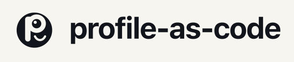

# profile-as-code

<p align="center">
  
</p>

**Tu identidad profesional como código.** Un solo source of truth versionado (YAML) → textos optimizados
por plataforma (LinkedIn, GitHub, Upwork, X, ResearchGate…) con **skills especializadas por plataforma** que codifican el
conocimiento SOTA de cada red, y un CLI diseñado para que los **agentes de IA y harnesses** auditen, mantengan y auditen tu perfil de forma autónoma.

> CLI-first · TypeScript · Agente-first (Harness-ready) · Sin infraestructura · Tus datos siempre tuyos.


[](https://github.com/ChristianLuciani/profile-as-code/discussions)
[](https://github.com/sponsors/ChristianLuciani)

**Project page:** [christianluciani.github.io/profile-as-code](https://christianluciani.github.io/profile-as-code/) —
la misma entrada, para quien no llega por el repositorio.

**¿Primera vez acá?** [START-HERE](docs/START-HERE.md) elige la ruta según quién sos (persona sin
terminal · contribuidor · agente); [USER-GUIDE](docs/USER-GUIDE.md) es la referencia completa.

## Para quién es (y qué necesitás)

**Es una herramienta para personas técnicas**: lo mínimo es una terminal y **Node.js ≥ 22**.
El workspace **es una carpeta**; un repo es el lugar **recomendado** para guardarla, no un
requisito (SPEC §9). Tres on-ramps, cada uno con su diferencia de capacidades al frente:

| On-ramp | Qué te da | Automatización + historial | Cuenta + repo |
|---|---|---|---|
| **Template repo** (recomendado) | workspace de ejemplo completo, docs operativas, licencia, automatización | sí | **requerido** |
| **`pasco init`** local | carpeta mínima y válida en segundos | **no** | **ninguno** |
| **Traé tu almacenamiento** | el mismo `pasco init`, escrito en la ruta que elijas (disco, nube, otro host git) | igual que `pasco init` | **ninguno** |

El paquete `@profile-as-code/cli` está **publicado en npm** (@profile-as-code/cli@0.5.0 — `npm view`, checked 2026-11-12), así que los dos
caminos sin cuenta funcionan hoy sin acceso a ningún repo. El template repo (on-ramp A) es
**público** (verificado 2026-11-12: `gh repo view ChristianLuciani/profile-data-template
--json visibility` → `PUBLIC`, HTTP 200), así que **Use this template** resuelve para cualquiera
— la cuenta y el repo siguen siendo el requisito del on-ramp A (STANDARDS community item 10).

El camino **hosted** — un perfil publicado por nosotros, sin cuenta y sin terminal — es un
**no-goal declarado de v1**: ninguno de estos on-ramps llega ahí, y su trigger de reapertura
vive en el [SPEC §2](docs/SPEC.md). M5 es un renderer de consumo, no un onboarding hosted
(SPEC §12).

Instalación, verificación y el paso a paso de cada on-ramp: [**User Guide**](docs/USER-GUIDE.md) (EN).
Acá abajo, el qué y el por qué.

## Problema

El mismo perfil vive en 8+ plataformas, cada una con reglas, límites y audiencias distintas. Se editan a mano,
se desincronizan, y los hechos (fechas, proyectos, publicaciones) se contradicen entre redes. No existe forma
de *versionar* tu presencia profesional ni de hacerla consistente sin copiar-pegar.

## Enfoque

```
        ┌───────────────────────────────────────────────────────┐
        │                 REPO PÚBLICO (producto)               │
        │  ┌─────────┐  ┌───────────────┐  ┌─────────────────┐  │
        │  │  DATA   │→ │  CORE         │→ │  RENDERERS      │  │
        │  │  YAML   │  │  validación   │  │  linkedin/      │  │
        │  │  +schema│  │  normalización│  │  upwork/github/ │  │
        │  │         │  │  drift-check  │  │  x/researchgate/│  │
        │  │         │  │  geo-check    │  │  substack       │  │
        │  └─────────┘  └───────────────┘  └─────────────────┘  │
        │        CI: validate · lint · tests · build            │
        └───────────────┬──────────────────────────┬────────────┘
                        │ datos del usuario        │ outputs listos
        ┌───────────────▼──────────┐   ┌───────────▼──────────────┐
        │  REPO PRIVADO (tuyo)     │   │  deploy: pegar (LinkedIn,│
        │  facts/*.yaml          │   │  Upwork…) o git/API      │
        │  profiles/ (generados)   │   │  (GitHub README, web)    │
        │  CHANGELOG · CHECKLIST   │   │                          │
        └──────────────────────────┘   └──────────────────────────┘
```

- **Hechos y storytelling separados:** los datos son deterministas (schema, validación, drift-check);
  los textos son *ángulos* por plataforma, generados con asistencia de agentes de IA y **elegidos por vos** (variantes que revisás y aprobás).
- **Skills SOTA por plataforma** (14 skills empaquetadas en el CLI para LinkedIn, Upwork, GitHub, Substack, Ko-fi, X…): límites oficiales de caracteres, reglas de indexación/**SEO+GEO**,
  ángulos por audiencia, trampas conocidas y *checks* ejecutables. Se exportan directamente con `pasco skills:export <dir>` para integrarlas en tus agentes y harnesses.
- **Agent-First y Harness-Ready:** diseñado desde la raíz para la automatización asistida por IA. Salidas `--json` estructuradas en todos los comandos clave, códigos de salida deterministas, edición atómica sin pérdida de comentarios (`pasco edit <path> --set <val> [--check]`), y plantillas de refinamiento (`pasco refine`).
- **GEO (Generative Engine Optimization) y Citabilidad de IA:** los LLM y motores de respuesta (Perplexity, ChatGPT, Claude) leen y citan perfiles profesionales hoy.
  La consistencia factual cross-platform ES citabilidad: un modelo que cruza LinkedIn vs GitHub y encuentra
  contradicciones te descarta. `pasco` garantiza hechos idénticos, anclas semánticas, proyección Schema.org JSON-LD paste-ready (`pasco entity --jsonld`), verificación offline de citas (`pasco cite-check`), y directivas claras para rastreadores (`pasco export ai-policy`).
- **Privacidad y soberanía de datos (Local-first):** tus datos residen en tu máquina o en tu propio repositorio privado. Control de visibilidad granular (`visibility: public` / `private`) con auditoría de fugas (`pasco audit --public`). Ninguna cuenta forzada ni telemetría oculta.
- **Multilingüe:** contenido por idioma (`EN` esencial para reclutadores internacionales, `ES` nativo,
  `FR` deseable). Docs del repo en inglés (D8).
- **Deploy como checklist y verificación en vivo:** las plataformas sin API (LinkedIn, Upwork) se marcan como "pegar + verificar";
  las que tienen API (GitHub) se actualizan por git/API. `pasco status --mark` confirma el deploy
  (`attested`, §19.5) y `pasco status --verify` —opt-in, el único camino con red— comprueba que la
  página viva siga coincidiendo con el ancla, reportando honestamente cualquier drift externo.

## Ventajas y Beneficios para el Usuario

| ¿Qué te preocupa? | La solución de `profile-as-code` | Beneficio concreto |
|---|---|---|
| **Perfiles desincronizados** | Una sola fuente de verdad en YAML (`facts/*.yaml`) compilada a cada red. | Modificás un puesto o logro una sola vez; `pasco build` genera los textos optimizados para cada plataforma y `pasco status` te permite trackear qué perfiles ya actualizaste manualmente. |
| **Límites de caracteres y reglas rotas** | Compilación determinista con validación de schema y 14 skills SOTA de plataformas. | Tu biografía o experiencia encaja exactamente en los límites y aprovecha el algoritmo de cada red. |
| **Pérdida de citabilidad ante IAs (GEO)** | Generación de Schema.org JSON-LD (`pasco entity`), verificación offline (`cite-check`) y políticas IA (`export ai-policy`). | Los motores de respuesta (Perplexity, ChatGPT, Gemini) indexan y citan tu trayectoria sin inventar datos. |
| **Trabajo manual repetitivo** | CLI optimizado para agentes de IA (flags `--json`, `edit --list`, `edit --set --check`, `refine`). | Tu agente inteligente (Claude, Pi, Cursor, DSH) puede auditar, proponer cambios y actualizar tu perfil de forma segura. |
| **Riesgo de fugar datos privados** | Campos con `visibility: private` por defecto y auditoría estricta (`pasco audit --public`). | Notas personales, compensaciones o datos de contacto confidenciales jamás se publican accidentalmente. |
| **Visualización antes de publicar** | Vista previa HTML local y autónoma con `pasco preview`. | Inspeccionás exactamente cómo se ve cada perfil antes de copiarlo o hacer push. |

## Qué podés hacer con el CLI `pasco` (v0.5.0)

El CLI `pasco` ofrece un conjunto integral de comandos para gestionar el ciclo de vida completo de tu perfil:

- 🚀 **`pasco init [dir] [--flavor brand]`** — Inicializa un nuevo workspace con estructura completa, listo para personas u organizaciones (`brand`).
- 🩺 **`pasco doctor [--json]`** — Revisa la salud del entorno, requisitos de Node/motor, schema y deltas de migración pendientes.
- ✅ **`pasco validate [--json]`** — Valida tus datos contra el JSON Schema v2.0, verifica drifts entre hechos y perfiles, y comprueba consistencia GEO.
- 🔨 **`pasco build [platform] [--lang]`** — Compila determinísticamente los perfiles optimizados para cada plataforma configurada.
- 👁️ **`pasco preview [--out <dir>] [--no-open]`** — Genera una página HTML local y autónoma en `.pasco/preview/` para ver todos los perfiles renderizados en tu navegador.
- ✏️ **`pasco edit <path> [--set <text> [--check]]`** — Lee, previsualiza o modifica campos específicos del contrato YAML preservando comentarios (`--list` para explorar rutas disponibles).
- 🔍 **`pasco check [platform]`** — Ejecuta reglas offline de coherencia de marca, matriz de handles sociales, transporte de medios y presencia de hechos.
- 🛡️ **`pasco audit [--json] [--public]`** — Diagnóstico estricto offline en 3 clases: referencias rotas (`dangling-ref`), contradicciones (`contradiction`) y afirmaciones sin fuente (`unsourced-claim`).
- 🌐 **`pasco discover <url>...`** — Reconstruye un perfil inicial a partir de JSON-LD y metadatos públicos de tus perfiles existentes.
- 🏷️ **`pasco entity [--jsonld]`** — Proyecta tu perfil a Schema.org (`Person` / `Organization`) y genera bloques JSON-LD listos para incrustar en tu sitio web.
- 🎯 **`pasco cite-check`** — Verifica de forma offline y determinista si las respuestas de motores de IA citan con fidelidad tus fuentes declaradas.
- 🤖 **`pasco export ai-policy`** — Exporta `robots.txt`, `llms.txt` y `AI-POLICY.md` (permite indexación y búsqueda por IA, bloquea entrenamiento indiscriminado).
- 📦 **`pasco export profile`** — Emite el objeto de perfil normalizado y versionado para integraciones o scripts.
- 🧠 **`pasco skills:export <dir>`** — Exporta las 14 skills SOTA de plataformas para cargarlas inmediatamente en tu entorno de agentes (Claude Code, Pi, DSH, Cursor...).
- 🔄 **`pasco diff [--json]`** — Compara los perfiles generados contra tags Git o versiones previas para ver qué cambia antes de desplegar.
- 📊 **`pasco status [--mark] [--verify]`** — Consulta el ledger de despliegues (`facts/deployments.yaml`), marca despliegues manuales y verifica la vigencia de perfiles en vivo.
- 📦 **`pasco migrate [--json]`** — Actualiza automáticamente workspaces de versiones anteriores al Schema v2.0 preservando comentarios.

## Estado

<!-- gen:platform-status -->
<!-- GENERATED by scripts/gen-platforms/gen.mjs from platforms/registry.yaml — do not edit by hand. -->
Plataformas (enum D16): **49** (34 Postiz + 15 operator extras) · renderers: **9** · skills: **14**.
<!-- /gen -->

| Fase | Estado |
|---|---|
| Prior-art research | ✅ `docs/research/01-prior-art.md` |
| Spec (decisiones en §5) | ✅ `docs/SPEC.md` (GEO, i18n, profile-data, Substack, **brand flavor D15/§17**) |
| Investigación SOTA por plataforma | 🚧 `skills/github-readme` + `skills/github-org` + `skills/kofi` + `skills/hotmart`; resto: asistente **SOTA Research**, ver `docs/research/RUN.md` |
| Schema JSON v2.0 (contrato) | ✅ `schema/profile.schema.json` (person + brand flavor) |
| Core engine (load · drift · geo · compile) | ✅ `packages/core` (tests, CI) |
| CLI `pasco` | ✅ init·validate·build·diff·status; check ejecuta reglas offline M6/M7/M8 + `fact-present` (#283) + la advisory `text/same-across-platforms` (#462); `audit --json` ✅ (hallazgos: `dangling-ref` · `contradiction` · `unsourced-claim`, sin score); `entity --json/--jsonld` ✅ (proyección schema.org + bloque JSON-LD paste-ready, #287); gate de egreso D28 ✅ — un flip `private → public` o `--all` pide `--confirm <digest>` una vez (SPEC §7.11, #503/#520); refine 🚧; skills:export ✅ — detalle en [`packages/cli/README.md`](packages/cli/README.md) |
| Renderer GitHub (dogfood) | ✅ `github-readme` + `github-org` (brand) + la familia paste (`kofi` v1.7; `buymeacoffee`/`liberapay`/`gumroad`/`payhip` v1.8; `hotmart` v1.9) |

**Brand flavor (M6, D15):** el mismo engine modela identidades de marca — `pasco init
--flavor brand`, handle matrix (`socialHandles`), `schema.org/Organization` GEO,
renderer `github-org`. Primer workspace brand: Topia — planeado como repo privado
(recomendado, no requisito; la carpeta es el workspace, SPEC §9.1).

## Arranque (dev)

```bash
pnpm install
pnpm test            # workspace tests (vitest)
pnpm build           # build (CLI: tsup transpile-only — type gate is pnpm typecheck, #108)
pnpm typecheck       # tsc --noEmit, whole workspace (CI-enforced since #108)
pnpm lint            # style gate (Biome: lint + format + import order)
pnpm gen:zod         # regenera Zod desde schema/profile.schema.json (D3)
pnpm gen:platforms   # regenera las superficies derivadas desde platforms/registry.yaml (#154)
```

## Documentación

- [`docs/USER-GUIDE.md`](docs/USER-GUIDE.md) — guía de usuario: instalación → workspace → primer load de datos → updates (EN).
- [`docs/SPEC.md`](docs/SPEC.md) — el contrato del motor: goals, decisiones (§5), data model, core interfaces, GEO, roadmap, brand flavor (§17).
- [`docs/research/`](docs/research/) — prior-art + prompts de investigación SOTA por plataforma.
- [`schema/README.md`](schema/README.md) — el contrato de datos: mapping de archivos, semántica de validación.
- [`docs/SCHEMA-CONTRACT.md`](docs/SCHEMA-CONTRACT.md) — el contrato publicado para consumidores **sin** el engine: URL tag-pinned + sha256 del schema (y qué **no** cubre).
- [`docs/ci-cd.md`](docs/ci-cd.md) — protección de main, CI, dependabot (cómo y por qué).
- [`packages/core/README.md`](packages/core/README.md) — el motor: APIs, tests.

## Roadmap (M1–M5, detalle en SPEC §12)

1. **M1** spec + schema + core ✅ → **CLI `pasco` ✅** (init·validate·build·diff·status, audit + entity ✅; refine/check 🚧, skills:export ✅ — detalle en [`packages/cli/README.md`](packages/cli/README.md))
2. **M2** renderer `github-readme` + CI + dogfood
3. **M3** investigación SOTA → skills v1 + `pasco refine` (hub local)
4. **M4** renderers linkedin/upwork/x/researchgate/substack + playbooks + `pasco check`
5. **M5** renderer web, template `profile-data` release, CONTRIBUTING completo

## Estructura

```
profile-as-code/
├── schema/               # EL contrato (JSON Schema, semver, aditivo)
├── packages/
│   ├── core/             # ✅ load · drift · geo · compile (Zod desde schema)
│   ├── renderers/        # github-readme + github-org + kofi — más adapters por plataforma (seam de contribución)
│   └── cli/              # pasco — init·doctor·validate·build·preview·edit·check·audit·entity·cite-check·export·skills:export·diff·status·discover·migrate (v0.5.0)
├── skills/               # skills por plataforma (conocimiento SOTA)
├── templates/
│   ├── profile-data/       # on-ramp A: puntero al template repo del workspace (SPEC §9.2)
│   └── profile-data-brand/ # on-ramp B (brand): skeleton brand generado por `pasco init --flavor brand` (multi-workspace, §9.1/§17.2)
└── docs/                 # SPEC, research, ci-cd, build prompts
```

Los datos reales de cada usuario viven en una **carpeta propia** (privada por recomendación),
nunca aquí. La forma recomendada de crearla es el template repo — on-ramp A, ver
`docs/SPEC.md` §9.2; los on-ramps B (`pasco init`) y C (traé tu almacenamiento) no necesitan
cuenta ni repo.

## Comunidad

- 💬 [**Discussions**](https://github.com/ChristianLuciani/profile-as-code/discussions) — preguntas, ideas y chat. Issues: bugs y propuestas concretas.
- 🛠️ [**Contributing**](CONTRIBUTING.md) — guía completa: qué aportar, reglas, workflow de PR, skills.
- 🤝 [**Code of Conduct**](CODE_OF_CONDUCT.md) — Contributor Covenant.
- 🏛️ [**Governance**](GOVERNANCE.md) — modelo, aceptación de contribuciones, camino a co-maintainers.
- 🐛 Issues: [bug](https://github.com/ChristianLuciani/profile-as-code/issues/new?labels=bug&template=bug_report.yml) · [feature](https://github.com/ChristianLuciani/profile-as-code/issues/new?labels=enhancement&template=feature_request.yml) · [good first issue](https://github.com/ChristianLuciani/profile-as-code/labels/good%20first%20issue)
- 🔒 [**Security**](SECURITY.md) — reportes privados vía GitHub Security Advisories.

### Qué aportar hoy

- **PRs de renderers** — un adapter por plataforma en `packages/renderers/`.
- **PRs de skills** — conocimiento SOTA de una plataforma que no cubrimos (Behance, Xing, Indeed…).
  Toda skill pasa por review: sanitización + security scan + test de comportamiento.
- Regla de evidencia: toda afirmación cuantitativa de una skill lleva fuente + fecha.

## Sponsor this project

Si el proyecto te resulta útil, podés [patrocinarlo desde GitHub Sponsors](https://github.com/sponsors/ChristianLuciani),
dejar un tip en [Ko-fi](https://ko-fi.com/christianluciani) o apoyar en [Patreon](https://www.patreon.com/cluciani).
El patrocinio financia el trabajo sobre el **engine** (`packages/core`) y la **CLI `pasco`** (`packages/cli`):
el contrato de `docs/SPEC.md`, los renderers y las skills por plataforma. Qué **no** compra: no hay SLA
ni soporte prioritario, y no da influencia sobre el roadmap — las decisiones se discuten a la vista en
los issues y en `docs/SPEC.md`, y una propuesta se evalúa por sus méritos, no por quién la financia.
El proyecto sigue siendo MIT: el código ya es tuyo, pagues o no.

[](https://github.com/sponsors/ChristianLuciani)
[](https://ko-fi.com/christianluciani)
[](https://www.patreon.com/cluciani)

**Sponsors:** el nombre y logo de cada tier se publican acá, en orden de tier — no de
monto. Si sos el primero en tu tier, tu espacio ya está reservado.

## Marca

El isotipo, el lockup y la lámina de identidad viven en [`site/brand/`](site/brand/), con
el manual en [`BRAND.md`](site/brand/BRAND.md): construcción, color, tipografía y reglas
de uso. El código es MIT; **el nombre y el logo no** — ver [`TRADEMARK.md`](TRADEMARK.md)
y [`site/brand/LICENSE`](site/brand/LICENSE).

## Licencia

MIT para el código — ver [`LICENSE`](LICENSE). El nombre y el logo quedan fuera de esa
licencia: [`TRADEMARK.md`](TRADEMARK.md) y [`site/brand/LICENSE`](site/brand/LICENSE).
