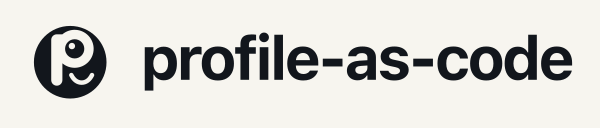

# profile-as-code

<p align="center">
  
</p>

**Tu identidad profesional como código.** Un solo source of truth versionado (YAML) → textos optimizados
por plataforma (LinkedIn, GitHub, Upwork, X, ResearchGate…) con **skills por plataforma** que codifican el
conocimiento SOTA de cada red.

> CLI-first · TypeScript · Sin infraestructura · Tus datos siempre tuyos.


[](https://github.com/ChristianLuciani/profile-as-code/discussions)
[](https://github.com/sponsors/ChristianLuciani)

**Project page:** [christianluciani.github.io/profile-as-code](https://christianluciani.github.io/profile-as-code/) —
la misma entrada, para quien no llega por el repositorio.

## Para quién es (y qué necesitás)

**Es una herramienta para personas técnicas**: lo mínimo es una terminal y **Node.js ≥ 22**.
El workspace **es una carpeta**; un repo es el lugar **recomendado** para guardarla, no un
requisito (SPEC §9). Tres on-ramps, cada uno con su diferencia de capacidades al frente:

| On-ramp | Qué te da | Automatización + historial | Cuenta + repo |
|---|---|---|---|
| **Template repo** (recomendado) | workspace de ejemplo completo, docs operativas, licencia, automatización | sí | **requerido** |
| **`pasco init`** local | carpeta mínima y válida en segundos | **no** | **ninguno** |
| **Traé tu almacenamiento** | el mismo `pasco init`, escrito en la ruta que elijas (disco, nube, otro host git) | igual que `pasco init` | **ninguno** |

El paquete `@profile-as-code/cli` está **publicado en npm** (0.3.0, 2026-10-11), así que los dos
caminos sin cuenta funcionan hoy sin acceso a ningún repo. El template repo (on-ramp A) sigue
privado y llega solo a quien ya tiene acceso, hasta el flip de familia (STANDARDS community
item 10).

El camino **hosted** — un perfil publicado por nosotros, sin cuenta y sin terminal — es un
**no-goal declarado de v1**: ninguno de estos on-ramps llega ahí, y su trigger de reapertura
vive en el [SPEC §2](docs/SPEC.md). M5 es un renderer de consumo, no un onboarding hosted
(SPEC §12).

Instalación, verificación y el paso a paso de cada on-ramp: [**User Guide**](docs/USER-GUIDE.md) (EN).
Acá abajo, el qué y el por qué.

## Problema

El mismo perfil vive en 8+ plataformas, cada una con reglas, límites y audiencias distintas. Se editan a mano,
se desincronizan, y los hechos (fechas, proyectos, publicaciones) se contradicen entre redes. No existe forma
de *versionar* tu presencia profesional ni de hacerla consistente sin copiar-pegar.

## Enfoque

```
        ┌──────────────────────────────────────────────────────┐
        │                 REPO PÚBLICO (producto)              │
        │  ┌─────────┐  ┌──────────────┐  ┌─────────────────┐  │
        │  │  DATA   │→ │  CORE        │→ │  RENDERERS      │  │
        │  │  YAML   │  │  validación  │  │  linkedin/      │  │
        │  │  +schema│  │  normalización│ │  upwork/github/ │  │
        │  │         │  │  drift-check │  │  x/researchgate/│  │
        │  │         │  │  geo-check   │  │  substack       │  │
        │  └─────────┘  └──────────────┘  └─────────────────┘  │
        │        CI: validate · lint · tests · build           │
        └───────────────┬──────────────────────────┬───────────┘
                        │ datos del usuario         │ outputs listos
        ┌───────────────▼──────────┐   ┌───────────▼──────────────┐
        │  REPO PRIVADO (tuyo)     │   │  deploy: pegar (LinkedIn,│
        │  content/*.yaml          │   │  Upwork…) o git/API      │
        │  profiles/ (generados)   │   │  (GitHub README, web)    │
        │  CHANGELOG · CHECKLIST   │   │                          │
        └──────────────────────────┘   └──────────────────────────┘
```

- **Hechos y storytelling separados:** los datos son deterministas (schema, validación, drift-check);
  los textos son *ángulos* por plataforma, generados con IA y **elegidos por vos** (3 variantes → elegís una).
- **Skills por plataforma** (una por LinkedIn, Upwork, GitHub, X…): límites oficiales, ranking/**SEO+GEO**,
  ángulos por audiencia, trampas y *checks* ejecutables. Se proyectan a tu skill-studio de agente.
- **GEO (generative engine optimization) como capa transversal:** los LLM leen y citan perfiles hoy.
  La consistencia factual cross-platform ES citabilidad — un modelo que cruza LinkedIn vs GitHub y encuentra
  contradicciones te descarta. El `geoCheck` del core garantiza hechos idénticos, anclas semánticas y
  readiness para datos estructurados (schema.org JSON-LD).
- **Multilingüe:** contenido por idioma (`EN` esencial para reclutadores internacionales, `ES` nativo,
  `FR` deseable). Docs del repo en inglés (D8).
- **Deploy como checklist:** las plataformas sin API (LinkedIn, Upwork) se marcan como "pegar + verificar";
  las con API (GitHub) se actualizan por git/API. `pasco status --mark` confirma el deploy
  (`attested`, §19.5) y `pasco status --verify` —opt-in, el único camino con red— comprueba que la
  página viva siga coincidiendo con el ancla, o lo reporta honestamente (`unverifiable`,
  `out-of-band-drift`).

## Estado

<!-- gen:platform-status -->
<!-- GENERATED by scripts/gen-platforms/gen.mjs from platforms/registry.yaml — do not edit by hand. -->
Plataformas (enum D16): **49** (34 Postiz + 15 operator extras) · renderers: **8** · skills: **6**.
<!-- /gen -->

| Fase | Estado |
|---|---|
| Prior-art research | ✅ `docs/research/01-prior-art.md` |
| Spec (D1–D18 resueltas) | ✅ `docs/SPEC.md` (GEO, i18n, profile-data, Substack, **brand flavor D15/§17**) |
| Investigación SOTA por plataforma | 🚧 `skills/github-readme` + `skills/github-org` + `skills/kofi` + `skills/hotmart`; resto: asistente **SOTA Research**, ver `docs/research/RUN.md` |
| Schema JSON v1.9 (contrato) | ✅ `schema/profile.schema.json` (person + brand flavor) |
| Core engine (load · drift · geo · compile) | ✅ `packages/core` (tests, CI) |
| CLI `pasco` | ✅ init·validate·build·diff·status; check ejecuta reglas offline M6/M7/M8 (catálogo M3/M4); refine 🚧; skills:export ✅ — detalle en [`packages/cli/README.md`](packages/cli/README.md) |
| Renderer GitHub (dogfood) | ✅ `github-readme` + `github-org` (brand) + la familia paste (`kofi` v1.7; `buymeacoffee`/`liberapay`/`gumroad`/`payhip` v1.8; `hotmart` v1.9) |

**Brand flavor (M6, D15):** el mismo engine modela identidades de marca — `pasco init
--flavor brand`, handle matrix (`socialHandles`), `schema.org/Organization` GEO,
renderer `github-org`. Primer workspace brand: Topia — planeado como repo privado
(recomendado, no requisito; la carpeta es el workspace, SPEC §9.1).

## Arranque (dev)

```bash
pnpm install
pnpm test            # workspace tests (vitest)
pnpm build           # build (CLI: tsup transpile-only — type gate is pnpm typecheck, #108)
pnpm typecheck       # tsc --noEmit, whole workspace (CI-enforced since #108)
pnpm lint            # style gate (Biome: lint + format + import order)
pnpm gen:zod         # regenera Zod desde schema/profile.schema.json (D3)
pnpm gen:platforms   # regenera las superficies derivadas desde platforms/registry.yaml (#154)
```

## Documentación

- [`docs/USER-GUIDE.md`](docs/USER-GUIDE.md) — guía de usuario: instalación → workspace → primer load de datos → updates (EN).
- [`docs/SPEC.md`](docs/SPEC.md) — el contrato del motor: goals, decisiones D1–D18, data model, core interfaces, GEO, roadmap, brand flavor (§17).
- [`docs/research/`](docs/research/) — prior-art + prompts de investigación SOTA por plataforma.
- [`schema/README.md`](schema/README.md) — el contrato de datos: mapping de archivos, semántica de validación.
- [`docs/ci-cd.md`](docs/ci-cd.md) — protección de main, CI, dependabot (cómo y por qué).
- [`packages/core/README.md`](packages/core/README.md) — el motor: APIs, tests.

## Roadmap (M1–M5, detalle en SPEC §12)

1. **M1** spec + schema + core ✅ → **CLI `pasco` ✅** (init·validate·build·diff·status; refine/check 🚧, skills:export ✅ — detalle en [`packages/cli/README.md`](packages/cli/README.md))
2. **M2** renderer `github-readme` + CI + dogfood
3. **M3** investigación SOTA → skills v1 + `pasco refine` (hub local)
4. **M4** renderers linkedin/upwork/x/researchgate/substack + playbooks + `pasco check`
5. **M5** renderer web, template `profile-data` release, CONTRIBUTING completo

## Estructura

```
profile-as-code/
├── schema/               # EL contrato (JSON Schema, semver, aditivo)
├── packages/
│   ├── core/             # ✅ load · drift · geo · compile (Zod desde schema)
│   ├── renderers/        # github-readme + github-org + kofi — más adapters por plataforma (seam de contribución)
│   └── cli/              # pasco — init·validate·build·diff·status ✅ (refine/check 🚧, skills:export ✅; check ejecuta reglas offline M6/M7/M8, igual que packages/cli/README.md)
├── skills/               # skills por plataforma (conocimiento SOTA)
├── templates/
│   ├── profile-data/       # on-ramp A: puntero al template repo del workspace (SPEC §9.2)
│   └── profile-data-brand/ # on-ramp B (brand): skeleton brand generado por `pasco init --flavor brand` (multi-workspace, §9.1/§17.2)
└── docs/                 # SPEC, research, ci-cd, build prompts
```

Los datos reales de cada usuario viven en una **carpeta propia** (privada por recomendación),
nunca aquí. La forma recomendada de crearla es el template repo — on-ramp A, ver
`docs/SPEC.md` §9.2; los on-ramps B (`pasco init`) y C (traé tu almacenamiento) no necesitan
cuenta ni repo.

## Comunidad

- 💬 [**Discussions**](https://github.com/ChristianLuciani/profile-as-code/discussions) — preguntas, ideas y chat. Issues: bugs y propuestas concretas.
- 🛠️ [**Contributing**](CONTRIBUTING.md) — guía completa: qué aportar, reglas, workflow de PR, skills.
- 🤝 [**Code of Conduct**](CODE_OF_CONDUCT.md) — Contributor Covenant.
- 🏛️ [**Governance**](GOVERNANCE.md) — modelo, aceptación de contribuciones, camino a co-maintainers.
- 🐛 Issues: [bug](https://github.com/ChristianLuciani/profile-as-code/issues/new?labels=bug&template=bug_report.yml) · [feature](https://github.com/ChristianLuciani/profile-as-code/issues/new?labels=enhancement&template=feature_request.yml) · [good first issue](https://github.com/ChristianLuciani/profile-as-code/labels/good%20first%20issue)
- 🔒 [**Security**](SECURITY.md) — reportes privados vía GitHub Security Advisories.

### Qué aportar hoy

- **PRs de renderers** — un adapter por plataforma en `packages/renderers/`.
- **PRs de skills** — conocimiento SOTA de una plataforma que no cubrimos (Behance, Xing, Indeed…).
  Toda skill pasa por review: sanitización + security scan + test de comportamiento.
- Regla de evidencia: toda afirmación cuantitativa de una skill lleva fuente + fecha.

## Sponsor this project

Si el proyecto te resulta útil, podés [patrocinarlo desde GitHub Sponsors](https://github.com/sponsors/ChristianLuciani).
El patrocinio financia el trabajo sobre el **engine** (`packages/core`) y la **CLI `pasco`** (`packages/cli`):
el contrato de `docs/SPEC.md`, los renderers y las skills por plataforma. Qué **no** compra: no hay SLA
ni soporte prioritario, y no da influencia sobre el roadmap — las decisiones se discuten a la vista en
los issues y en `docs/SPEC.md`, y una propuesta se evalúa por sus méritos, no por quién la financia.
El proyecto sigue siendo MIT: el código ya es tuyo, pagues o no.

**Sponsors:** todavía no hay ninguno. Los nombres y logos de quienes patrocinan se publican
en esta sección, en el orden de su tier — si sos el primero, tu nombre va acá.

## Marca

El isotipo, el lockup y la lámina de identidad viven en [`site/brand/`](site/brand/), con
el manual en [`BRAND.md`](site/brand/BRAND.md): construcción, color, tipografía y reglas
de uso. El código es MIT; **el nombre y el logo no** — ver [`TRADEMARK.md`](TRADEMARK.md)
y [`site/brand/LICENSE`](site/brand/LICENSE).

## Licencia

MIT para el código — ver [`LICENSE`](LICENSE). El nombre y el logo quedan fuera de esa
licencia: [`TRADEMARK.md`](TRADEMARK.md) y [`site/brand/LICENSE`](site/brand/LICENSE).
